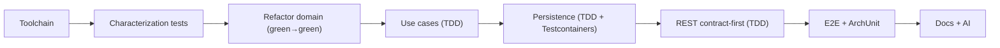

# Time Deposit Kata Implementation Plan (Commit-by-Commit)

> [!TIP]
> **Status: FINAL VERSION (`v4` — APPROVED FOR IMPLEMENTATION)**  
> This specification was refined through four iterations (`v1 → v2 → v3 → v4`) with cross-LLM architectural reviews before writing code. Section 10 provides the README requirements traceability matrix, and Section 11 summarizes the design evolution across all review rounds.

## 1. Current State

| Item | State |
| --- | --- |
| Language / Build | Kotlin **1.7.20**, Maven, target JVM 17, surefire 2.22 |
| Local environment | Homebrew `openjdk@21` and `openjdk@26` (keg-only, requires `JAVA_HOME`), **no** `mvn` installed, Docker available |
| `TimeDeposit.kt` | `data class (id, planType: String, var balance: Double, days)` in package `org.ikigaidigital` — **no withdrawals** |
| `TimeDepositCalculator.kt` | `if/else` on `planType` string, mutates list in-place, rounds via `BigDecimal(double).setScale(2, HALF_UP)` |
| `TimeDepositCalculatorTest.kt` | Dummy `assertThat(1).isEqualTo(1)` — no safety net |
| Spring / DB / API | Absent |
| git | Removed `time-deposit-kata-kotlin.iml` (uncommitted) |

Local build runs on JDK 21, targeting Java 17 bytecode:

```bash
export JAVA_HOME=/opt/homebrew/opt/openjdk@21/libexec/openjdk.jdk/Contents/Home
```

### Exact `updateBalance` Behavior (Contract That Must Not Be Broken)

- `days > 30` (strictly) — otherwise `0` for all plans.
- `student`: only when `days < 366` → `balance * 0.03 / 12`.
- `premium`: only when `days > 45` → `balance * 0.05 / 12`.
- `basic`: `balance * 0.01 / 12`.
- Unknown `planType` (including case differences like `"Basic"`) → `0`, no exception thrown.
- Interest is calculated in `Double`, rounded **via `BigDecimal(double)`** (not `valueOf`) to 2 decimal places with `HALF_UP`, then added back to `Double`.
- The input list is mutated in-place; an empty list is a no-op.

## 2. Strict Backward Compatibility Constraints

> [!IMPORTANT]
> These rules apply across **all** commits and are codified in `AGENTS.md`.

1. `TimeDeposit` and `TimeDepositCalculator` **remain in package `org.ikigaidigital`**. Do not move them to `..domain..`: external evaluator tests may import them from the original package path.
2. `TimeDeposit` remains unchanged (fields, types, `var balance`, constructor parameter order).
3. `TimeDepositCalculator()` can be instantiated **with no arguments**: dependencies must have default values
   (`class TimeDepositCalculator(private val policies: InterestPolicyRegistry = InterestPolicyRegistry.default())`).
4. Signature `fun updateBalance(xs: List<TimeDeposit>)` remains unchanged.
5. Rounding formula remains unchanged: `BigDecimal(interest).setScale(2, RoundingMode.HALF_UP).toDouble()`.
6. Bytecode target is **Java 17** (`jvmTarget=17`). The project must compile and run on any JDK 17+ in the evaluators' environment.

## 3. Architecture

### Packages (Hexagonal)

```
org.ikigaidigital                         ← legacy core: TimeDeposit, TimeDepositCalculator (do not move) + Application.kt
org.ikigaidigital.domain                  ← InterestPolicy, eligibility rules, Withdrawal, TimeDepositView
org.ikigaidigital.application             ← inbound ports (use case interfaces), services, outbound ports; no Spring
org.ikigaidigital.adapter.rest            ← controllers + DTO mapper
org.ikigaidigital.adapter.rest.api        ← generated by openapi-generator (API interface)
org.ikigaidigital.adapter.rest.dto        ← generated by openapi-generator (TimeDepositDto, WithdrawalDto)
org.ikigaidigital.adapter.persistence     ← JPA entities, Spring Data repositories, port adapters
org.ikigaidigital.config                  ← use case wiring, transactional decorator
```

"Domain" for ArchUnit is **strictly** package `org.ikigaidigital` (without subpackages, **excluding `Application`**) plus `org.ikigaidigital.domain..`.

> [!IMPORTANT]
> `Application.kt` (`@SpringBootApplication`) resides in the **root** package `org.ikigaidigital`, not in `config`. Otherwise component scanning, `@EntityScan`, and `@SpringBootConfiguration` discovery from `@DataJpaTest`/`@WebMvcTest` in sibling packages (`adapter.*`) would not find each other without manual overrides. Therefore, the ArchUnit rule for the root package explicitly excludes `Application`.

### Interest Calculation (Strategy + Composition)

- `InterestPolicy { fun monthlyInterest(deposit: TimeDeposit): Double }`. Returns interest **before rounding**; rounding stays in the calculator.
- Plan policy = annual rate + set of eligibility rules (`EligibilityRule`):
  - `MinAgeRule(30)` — shared "no interest for the first 30 days" rule for **existing** plans;
  - `MinAgeRule(45)` — for `premium`;
  - `MaxAgeRule(365)` — for `student`.
- `InterestPolicyRegistry`: `Map<String, InterestPolicy>`, unknown plan → `NoInterest`.
- Adding a new plan = adding a new registry entry. Its own grace period is configured via rules without modifying existing classes (OCP).

### Persistence Without Losing Withdrawals

- Outbound ports are segregated by responsibility:
  - `TimeDepositRepository.findAll(): List<TimeDeposit>`
  - `TimeDepositRepository.updateBalances(deposits: List<TimeDeposit>)` — updates **only** `balance`
  - `TimeDepositReadRepository.findAllWithWithdrawals(): List<TimeDepositView>`
- `updateBalances` is implemented via `@Modifying(clearAutomatically = true, flushAutomatically = true) @Query("update TimeDepositEntity e set e.balance = :balance where e.id = :id")`. The flags ensure Hibernate's 1st-level cache (`PersistenceContext`) does not return stale balances on subsequent reads within the same transaction.
- `TimeDepositEntity` has **no** `@OneToMany`, cascades, or `orphanRemoval`. `WithdrawalEntity` stores `timeDepositId` (FK in DB).
- Read model is assembled via two queries (all time deposits + all withdrawals) and grouped in memory in $O(N)$, avoiding N+1 queries.
- Mapping `Double → BigDecimal`: `BigDecimal.valueOf(balance).setScale(2, HALF_UP)`. **Never** `BigDecimal(balance)`: `Double` addition can accumulate IEEE 754 representation tails like `1000.1000000000001`.
- `spring.jpa.hibernate.ddl-auto=validate`: Flyway owns the schema, Hibernate only validates entities against it.

### Transactions Without Spring in the Application Layer

- Inbound ports are interfaces: `fun interface UpdateAllBalancesUseCase { fun execute() }`, `fun interface GetAllTimeDepositsUseCase { fun execute(): List<TimeDepositView> }`. Implementations are `UpdateAllBalancesService` and `GetAllTimeDepositsService` (plain Kotlin classes without `@Transactional` or `open`).
- Controllers depend only on the inbound port interfaces.
- In `config.UseCaseConfig`, **only** the decorator `TransactionalUpdateAllBalances(delegate, transactionTemplate)` is registered as the `UpdateAllBalancesUseCase` bean: `transactionTemplate.executeWithoutResult { delegate.execute() }`. The underlying service is instantiated inside the config method and not exposed as a separate bean, avoiding bean ambiguity and eliminating the need for `@Primary`.

## 4. TDD Modes

1. **Legacy refactoring** (calculator) — start with *characterization tests*: they lock down current behavior and pass immediately. Subsequent refactoring proceeds green → green.
2. **New functionality** (use cases, DB, API) — Red → Green → Refactor. Both test and implementation go into **a single commit**, keeping the build green at every commit (Decision 1). "(red)" in the commit tables below denotes the workflow order within a commit, not a separate failing commit.



## 5. Commit Plan

Format — Conventional Commits. Every commit must pass `./mvnw verify`.

### Phase 0 — Infrastructure & AI Spec

| # | Commit | Summary |
| --- | --- | --- |
| 1 | `chore(ai): add implementation plan and agent rules` | `docs/implementation_plan.md` + `AGENTS.md` / `.agents/rules`: TDD, hexagonal, atomic commits, **constraints from Section 2** |
| 2 | `chore: stop tracking IDE .iml file` | remove `.iml`, add `*.iml` to `.gitignore` |
| 3 | `build: add Maven Wrapper` | no local `mvn` → generate via Docker: `docker run --rm -v "$PWD":/w -w /w maven:3.9-eclipse-temurin-21 mvn -N wrapper:wrapper` |
| 4 | `build: upgrade Kotlin to 2.x and surefire to 3.x` | `java.version`/`jvmTarget` **remain 17**; verify existing test runs on `openjdk@21` |

### Phase 1 — Safety Net

| # | Commit | Summary |
| --- | --- | --- |
| 5 | `test: characterize TimeDepositCalculator behaviour` | `@ParameterizedTest`: days `0, 29, 30, 31, 45, 46, 365, 366, 1000` × all plans; unknown plan; case sensitivity (`"Basic"`); `HALF_UP` rounding (`x.xx5` boundary case); empty list; multiple deposits; in-place mutation; no-arg `TimeDepositCalculator()` call. Remove dummy assert |

### Phase 2 — Domain Refactoring (green → green)

| # | Commit | Summary |
| --- | --- | --- |
| 6 | `refactor: extract interest rounding into private helper` | `roundInterest(d: Double) = BigDecimal(d).setScale(2, HALF_UP).toDouble()` — **exact same** formula |
| 7 | `feat(domain): add composable InterestPolicy for basic/student/premium` | TDD: tests for `MinAgeRule`/`MaxAgeRule` and each policy → implementation + `InterestPolicyRegistry.default()`. Not wired into calculator yet |
| 8 | `refactor: delegate TimeDepositCalculator to policy registry` | constructor with default argument, package `org.ikigaidigital`, signature unchanged; tests from #5 pass without modification |

### Phase 3 — Spring Boot Skeleton

| # | Commit | Summary |
| --- | --- | --- |
| 9 | `build: add Spring Boot 3, Web, JPA, PostgreSQL, Testcontainers` | Spring Boot 3.5.x: `starter-web`, `starter-data-jpa`, `postgresql`, `testcontainers` (`postgresql`, `junit-jupiter`), `kotlin-spring`/`kotlin-jpa` plugins. `Application.kt` in **root** package, `contextLoads` with `@ServiceConnection` PostgreSQL. **Do not add Flyway yet** — it will be added along with the first migration in #13 |

### Phase 4 — Application Layer (TDD, No Spring)

| # | Commit | Summary |
| --- | --- | --- |
| 10 | `feat(domain): add Withdrawal model and repository ports` | `Withdrawal(id, timeDepositId, amount: BigDecimal, date: LocalDate)`, `TimeDepositView(deposit, withdrawals)`, outbound ports from Section 3 |
| 11 | `feat(app): add UpdateAllBalances use case` | inbound port `UpdateAllBalancesUseCase` (interface) + `UpdateAllBalancesService`. In-memory fake → `findAll` → `calculator.updateBalance` → `updateBalances`. Test: withdrawals in fake store remain untouched |
| 12 | `feat(app): add GetAllTimeDeposits use case` | inbound port `GetAllTimeDepositsUseCase` + `GetAllTimeDepositsService`, returns `List<TimeDepositView>` |

### Phase 5 — Persistence Adapter

| # | Commit | Summary |
| --- | --- | --- |
| 13 | `feat(db): add Flyway schema for time deposits and withdrawals` | `flyway-core` + **`flyway-database-postgresql`** (required for Flyway 10+). `V1__schema.sql` — DDL below, comment explaining `camelCase` → `snake_case` mapping from README |
| 14 | `feat(db): implement JPA persistence adapter` | `@DataJpaTest` + Testcontainers (red) → entities **without cascades**, repositories, `@Modifying(clearAutomatically, flushAutomatically)`, mapper, adapters, `ddl-auto=validate`. Tests: `updateBalances` does not touch withdrawals; updated balance is immediately visible within the same transaction; read without N+1; mapping `1000.1000000000001 → 1000.10` |
| 15 | `feat(db): add local seed data` | `src/main/resources/db/seed/V1_1__seed.sql`, enabled only in `local` profile: `spring.flyway.locations=classpath:db/migration,classpath:db/seed`. Automated tests see a clean database |
| 16 | `feat(config): wire use cases as Spring beans` | `UseCaseConfig`: beans `TimeDepositCalculator`, `UpdateAllBalancesUseCase` (= `TransactionalUpdateAllBalances` wrapping the service), `GetAllTimeDepositsUseCase`. Unit test for decorator (delegate invoked inside transaction) + `@SpringBootTest` with Testcontainers: context starts, beans are unique |

DDL (Commit 13) — columns and types matching README, `snake_case` identifiers:

```sql
-- README: timeDeposits(id, planType, days, balance) → time_deposits; camelCase → snake_case (PostgreSQL/Hibernate convention)
CREATE TABLE time_deposits (
    id        INTEGER        PRIMARY KEY,
    plan_type VARCHAR(50)    NOT NULL,
    days      INTEGER        NOT NULL,
    balance   NUMERIC(19, 2) NOT NULL
);
-- README: withdrawals(id, timeDepositId, amount, date)
CREATE TABLE withdrawals (
    id              INTEGER        PRIMARY KEY,
    time_deposit_id INTEGER        NOT NULL REFERENCES time_deposits (id),
    amount          NUMERIC(19, 2) NOT NULL,
    date            DATE           NOT NULL
);
CREATE INDEX idx_withdrawals_time_deposit_id ON withdrawals (time_deposit_id);
```

`id` is `INTEGER` without auto-generation: neither endpoint creates records; data comes from seed scripts or test fixtures (documented assumption).

### Phase 6 — REST Adapter (Contract-First)

| # | Commit | Summary |
| --- | --- | --- |
| 17 | `feat(api): add OpenAPI contract and code generation` | contract in **`src/main/resources/static/openapi.yaml`** (also used as `inputSpec`), **exactly 2 operations**. `openapi-generator-maven-plugin` configuration below. Schemas in Section 6 |
| 18 | `feat(api): implement GET /time-deposits` | `@WebMvcTest` (red) → controller implements generated interface, domain → `TimeDepositDto` mapper. `POST` temporarily returns `501` from the interface default method |
| 19 | `feat(api): implement POST /time-deposits/balance-updates` | `@WebMvcTest` (red) → override method, return `204 No Content` |
| 20 | `feat(api): expose Swagger UI for the contract` | springdoc, `swagger-ui.url=/openapi.yaml`, `api-docs.enabled=false` (config below). Verify Swagger UI loads and triggers both endpoints |

Generator configuration (Commit 17):

```xml
<generatorName>kotlin-spring</generatorName>
<inputSpec>${project.basedir}/src/main/resources/static/openapi.yaml</inputSpec>
<apiPackage>org.ikigaidigital.adapter.rest.api</apiPackage>
<modelPackage>org.ikigaidigital.adapter.rest.dto</modelPackage>
<modelNameSuffix>Dto</modelNameSuffix>
<configOptions>
  <interfaceOnly>true</interfaceOnly>
  <useSpringBoot3>true</useSpringBoot3>
  <useTags>true</useTags>
  <!-- omit io.swagger.v3.* annotations: springdoc is added in #20,
       and Swagger UI reads static openapi.yaml directly -->
  <documentationProvider>none</documentationProvider>
  <!-- input validation is not required by README; avoids needing starter-validation (jakarta.validation) -->
  <useBeanValidation>false</useBeanValidation>
  <!-- do NOT enable skipDefaultInterface: default methods return 501,
       allowing GET and POST to be implemented in separate commits -->
</configOptions>
```

The generated source directory (`target/generated-sources/openapi/src/main/kotlin`) is added to `sourceDirs` in `kotlin-maven-plugin` so the Kotlin compiler picks it up.

Swagger UI configuration (Commit 20):

```yaml
springdoc:
  api-docs:
    enabled: false        # do not expose dynamic /v3/api-docs: static/openapi.yaml is the single contract
  swagger-ui:
    url: /openapi.yaml
```

> [!NOTE]
> If the specific springdoc version does not render Swagger UI when `api-docs.enabled=false`, keep `api-docs` enabled while pointing `swagger-ui.url` to `/openapi.yaml`, and document the reason in `application.yml`.

### Phase 7 — End-to-End & Architecture Checks

| # | Commit | Summary |
| --- | --- | --- |
| 21 | `test: add end-to-end API test with Testcontainers` | test inserts its own fixtures → `POST` → `GET`: balances updated, withdrawals preserved |
| 22 | `test: enforce hexagonal boundaries with ArchUnit` | rules below |

ArchUnit rules (Commit 22):

- `resideInAPackage("org.ikigaidigital")` (**without** `..`, excluding `Application`) and `org.ikigaidigital.domain..` must not depend on `org.springframework..`, `jakarta..`, `..application..`, `..adapter..`, `..config..`.
- `..application..` must not depend on `..adapter..`, `..config..`, `org.springframework..`, `jakarta..`.
- `..adapter.rest..` and `..adapter.persistence..` must not depend on each other.
- Generated code (`..adapter.rest.api..`, `..adapter.rest.dto..`) lives inside `adapter.rest` and is governed by the adapter layer rules.

### Phase 8 — Documentation

| # | Commit | Summary |
| --- | --- | --- |
| 23 | `chore: add docker-compose for local PostgreSQL` | + local profile startup configuration |
| 24 | `docs: describe how to run and call endpoints via Swagger` | In `README.md` (preserving original assignment text, appending a "How to Run" section): prerequisites (JDK 17+, Docker for Testcontainers and compose), `./mvnw verify`, `docker compose up -d` + `./mvnw spring-boot:run -Dspring-boot.run.profiles=local`, Swagger UI URL, step-by-step guide to trigger both endpoints via "Try it out", `curl` examples, documented assumptions |
| 25 | `docs: document AI-assisted workflow` | `AI_USAGE.md`: tools, rules, prompts, iterative specification refinement with cross-LLM reviews (`v1 → v2 → v3 → v4`), what was AI-assisted and why |

## 6. API Contract (Locked Before Commit 17)

| Operation | Method & Path | Response |
| --- | --- | --- |
| Update balances of all time deposits | `POST /time-deposits/balance-updates` | `204 No Content` |
| Retrieve all time deposits | `GET /time-deposits` | `200 OK`, `TimeDeposit[]` |

```yaml
TimeDeposit:        # Kotlin class: TimeDepositDto
  id: integer
  planType: string
  balance: number   # format: double, 2 decimal places
  days: integer
  withdrawals: Withdrawal[]
Withdrawal:         # Kotlin class: WithdrawalDto
  id: integer
  amount: number
  date: string      # format: date
```

`timeDepositId` is omitted from `Withdrawal` in the JSON response because the relationship is already represented by nesting.

## 7. Assumptions (To Be Documented in Code Comments)

- **Balance update endpoint:** `POST /time-deposits/balance-updates` → `204`. The exact path is not prescribed in README; `POST` is chosen because the operation is not idempotent.
- Each `POST` call applies one monthly interest accrual; `days` is not incremented.
- Withdrawals do not affect interest calculation and are not modified when updating balances.
- Domain `balance` remains `Double` (per README constraint), while DB column is `NUMERIC(19,2)`.
- `planType` values are lowercase strings, matching the existing codebase.
- The "first 30 days without interest" rule applies to existing plans; future plans can define their own grace period via eligibility rules.
- Swagger UI and static `openapi.yaml` are documentation assets, not business "API endpoints"; Spring Boot Actuator is not included to strictly respect the "exactly two API endpoints" guideline.

## 8. Key Decisions

1. **Commits:** test and implementation go into the same commit. Every commit is atomic and keeps `./mvnw verify` green.
2. **Database naming:** `snake_case` (`time_deposits`, `withdrawals`, `plan_type`, `time_deposit_id`) — standard PostgreSQL convention and Hibernate default in Spring Boot. Mapping to the `camelCase` names in README is explained in a comment in `V1__schema.sql`. JSON API uses `camelCase`.
3. **Tech stack:** Kotlin + Spring Boot 3 + PostgreSQL (Testcontainers for tests, `docker-compose` for local runs).

## 9. Implementation Verification Checklist

- `flyway-database-postgresql` is present — required for Flyway 10+ to work with PostgreSQL (#13).
- `springdoc` behavior when `api-docs.enabled=false` (#20, see NOTE).
- Default methods on the generated API interface return `501` in the chosen generator version (#17–18).
- Generated code compiles without `swagger-annotations` and `jakarta.validation` (#17).
- `@DataJpaTest` uses the PostgreSQL container rather than replacing it with an embedded DB (`@AutoConfigureTestDatabase(replace = NONE)` if required by the Spring Boot version) (#14).

## 10. README Requirements Traceability Matrix

Verification that the plan fulfills every assignment requirement without scope creep.

| README Requirement | Where in Plan | Status |
| --- | --- | --- |
| 1. Endpoint: update balances of all time deposits | #19, Section 6 | ✅ |
| 1. Endpoint: retrieve all time deposits (`id, planType, balance, days, withdrawals`) | #18, Section 6 | ✅ |
| 2. Store time deposits in a database | #13–14 | ✅ |
| 2. Table `timeDeposits`: `id` PK, `planType`, `days`, `balance` — all required | DDL #13 | ✅ `snake_case` names (Decision 2) |
| 2. Table `withdrawals`: `id` PK, `timeDepositId` FK, `amount`, `date` — all required | DDL #13 | ✅ `snake_case` names (Decision 2) |
| 3. Interest: basic 1% / student 3% up to 1 year / premium 5% after 45 days / no interest first 30 days | Section 1, #5, #7–8 | ✅ behavior preserved |
| 4. No breaking changes to `TimeDeposit` or `updateBalance` signature | Section 2 | ✅ |
| 4. Extensible interest calculation design | Section 3 (Strategy + rules) | ✅ |
| 5. SOLID, design patterns, clean code | Strategy, Decorator, Ports & Adapters, ArchUnit #22 | ✅ |
| 6. AI harness, tool documentation, rules/prompts, summary of AI usage | #1, #25 | ✅ |
| Existing `updateBalance` behavior remains unchanged | #5 (characterization) | ✅ |
| **Exactly two** API endpoints | Section 6, Section 7 (Swagger UI is docs, no Actuator) | ✅ |
| Fork repository, no PR/branches in `ikigai-digital` repo | `origin` = `github.com/VladLerkin/...`, work on `main` | ✅ verified |
| Handling invalid input or exceptions is not required | `useBeanValidation=false`, no exception handlers | ✅ no overengineering |
| Justify assumptions in code comments | Section 7 | ✅ |
| Preferred: OpenAPI Swagger contract | #17, #20 | ✅ |
| Preferred: Hexagonal Architecture | Section 3, #22 | ✅ |
| Preferred: Atomic commits | Section 5, Decision 1 | ✅ |
| Preferred: Testcontainers | #9, #14, #16, #21 | ✅ |
| Submission: instructions to trigger endpoints via Swagger | #24 | ✅ |
| Submission: email link to public GitHub repo | — | manual post-completion step |

The only deliberate deviation is `snake_case` table and column names in PostgreSQL, justified via a comment in the SQL migration while preserving `camelCase` in the JSON API.

Additions beyond explicit README items (verified to directly support requirements rather than gold-plating):

- ArchUnit (#22) — enforces and proves Hexagonal Architecture boundaries.
- Transactional decorator (#16) — ensures atomic "update all balances" without leaking Spring into the `application` layer.
- `docker-compose` and local seed data (#15, #23) — enable easy manual testing via Swagger UI (Submission requirement).
- No extra endpoints, input validation, custom error handlers, or authentication are added.

## 11. Plan Evolution & Cross-LLM Review Changelog

### v3 Review → v4 (Final Adjustments)

| v3 Review Remark | Resolution in v4 |
| --- | --- |
| 1. `documentationProvider`: missing `io.swagger.v3.*` in #17 before springdoc is added in #20 | `documentationProvider=none` (#17) |
| 2. Kotlin classes are `final` by default → decorator needs an interface | Inbound ports are `fun interface`, services are separate (#11–12); only the decorator is exposed as a bean, no `@Primary` needed (#16) |

Additional refinements in v4:

- `useBeanValidation=false`: prevents missing `jakarta.validation` compilation errors in #17 without adding `spring-boot-starter-validation` (input validation is not required by README).
- Added generated sources directory to `sourceDirs` in `kotlin-maven-plugin`.
- Explicitly listed `spring-boot-starter-web` in Commit #9.
- Placed `Application.kt` in the root package `org.ikigaidigital` (so component scanning and `@DataJpaTest`/`@WebMvcTest` slice discovery work out of the box) and excluded `Application` in the root-package ArchUnit rule.
- Included explicit SQL DDL with column types matching README (`INTEGER`, `NUMERIC`, `DATE`, `NOT NULL`).
- Specified in Commit #24 that run instructions are appended to `README.md` without altering the original assignment text, including Docker as a prerequisite.
- Added Section 10: README requirements traceability matrix.

### v2 Review → v3

| v2 Review Remark | Resolution in v3 |
| --- | --- |
| 1. `openapi-generator` packages and name collision | `apiPackage`/`modelPackage` under `adapter.rest.*`, `modelNameSuffix=Dto` (#17, Section 3) |
| 2. Single generated interface across two commits | Keep default `skipDefaultInterface=false` so `POST` returns `501` until #19 |
| 3. Location of `openapi.yaml` | `src/main/resources/static/openapi.yaml` — single source of truth for both generator and Swagger UI |
| 4. Hibernate 1st-level cache on bulk update | `@Modifying(clearAutomatically = true, flushAutomatically = true)` + same-transaction re-read test (#14) |
| 5. Flyway added before first migration | Moved Flyway dependency to Commit #13 alongside `V1__schema.sql` |
| 6. `jvmTarget 21` vs evaluators on JDK 17 | Target Java 17 bytecode (Section 2, item 6; Commit #4) |

Additional refinements in v3:

- **New Commit #16 `feat(config)`:** wires use cases as Spring beans and wraps `UpdateAllBalances` in a `TransactionTemplate` decorator so the `application` layer stays Spring-free.
- Added `flyway-database-postgresql` (required for Flyway 10+ on PostgreSQL).
- Set `ddl-auto=validate` so Hibernate validates entities against the Flyway schema.
- Refined ArchUnit rules: `application` does not depend on `config` or Spring; added rule covering generated code.

### v1 Review → v2

| v1 Review Remark | Resolution in v2 |
| --- | --- |
| Moving `TimeDeposit` / `TimeDepositCalculator` to `domain` breaks external tests | Section 2: keep legacy classes in `org.ikigaidigital` with a no-arg constructor |
| Risk of losing `withdrawals` on `saveAll` | Segregated ports, `updateBalances` updates only `balance`, entities have no cascades, dedicated test |
| Money helper vs golden master rounding | Preserve exact `BigDecimal(double).setScale(2, HALF_UP)` rounding contract; remove redundant random golden master |
| `Double → NUMERIC(19,2)` precision | Use `BigDecimal.valueOf(...).setScale(2, HALF_UP)` + dedicated test |
| Table naming (`camelCase` vs `snake_case`) | Use `snake_case` + Hibernate default naming strategy, justify in `V1__schema.sql` comment |
| `withdrawals` schema in `GET` response | Explicitly defined in Section 6 |
| Grace period commits rewriting each other | Merged into a single commit (#7) using composable eligibility rules |
| Seed migration polluting integration tests | Moved seed script to `db/seed` under `local` profile; E2E test inserts its own fixtures |
| Local Maven Wrapper generation without `mvn` | Generate via Docker `maven:3.9-eclipse-temurin-21` (#3) |
